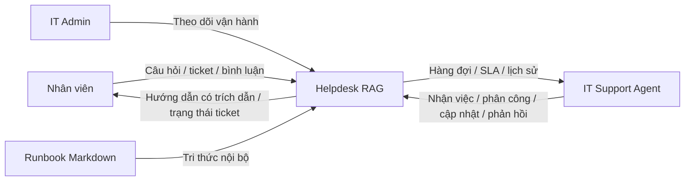
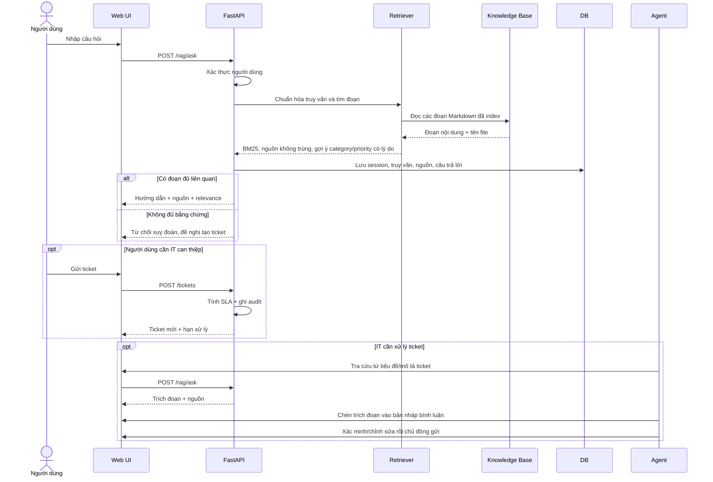
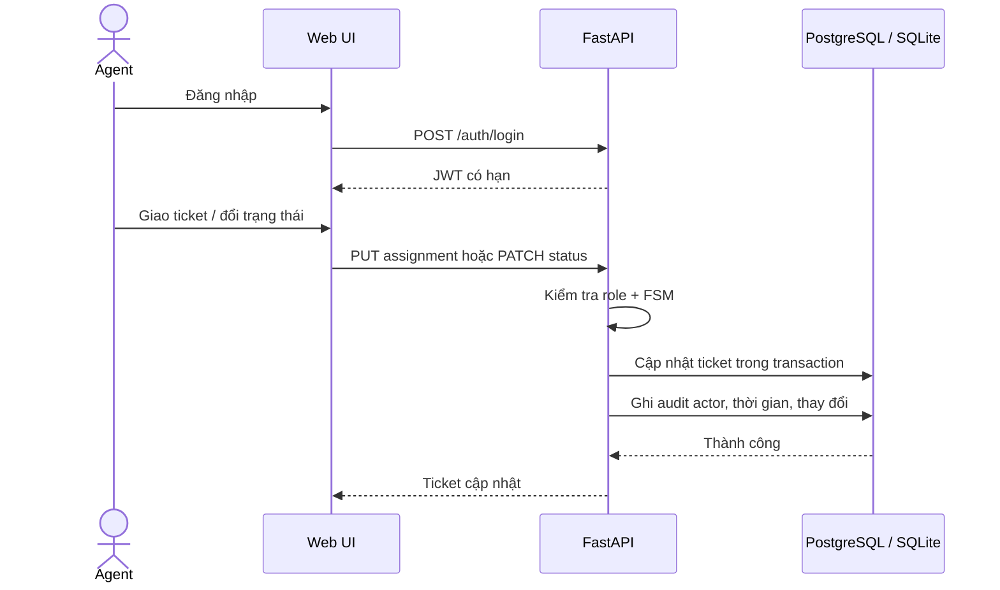
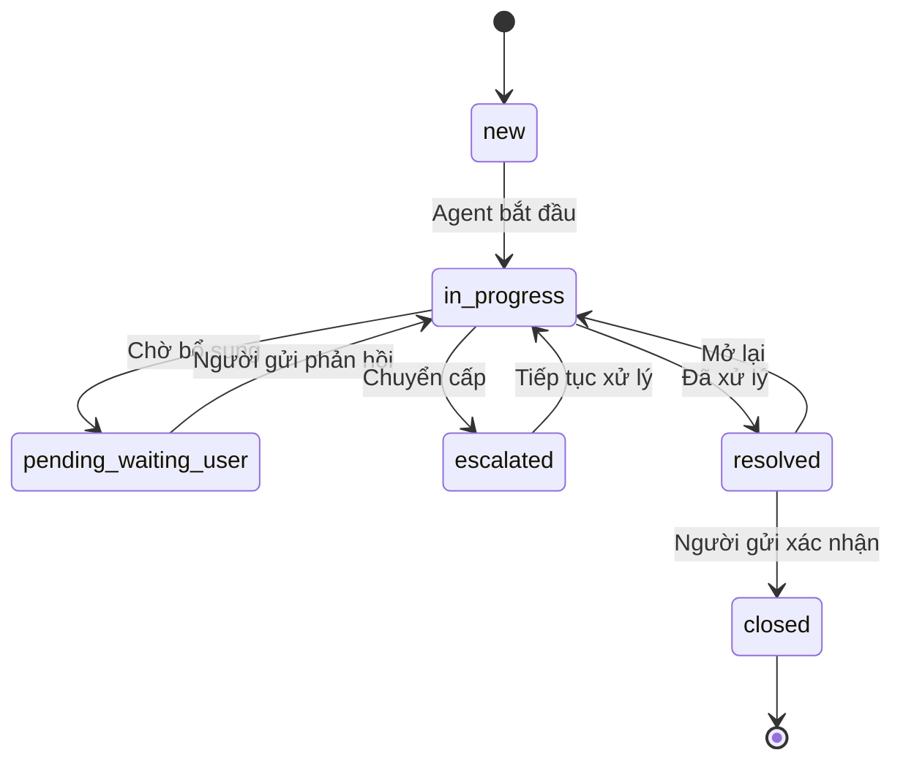
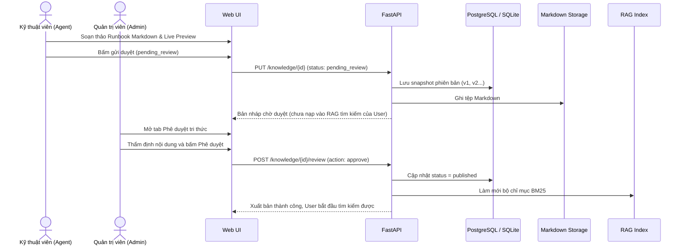
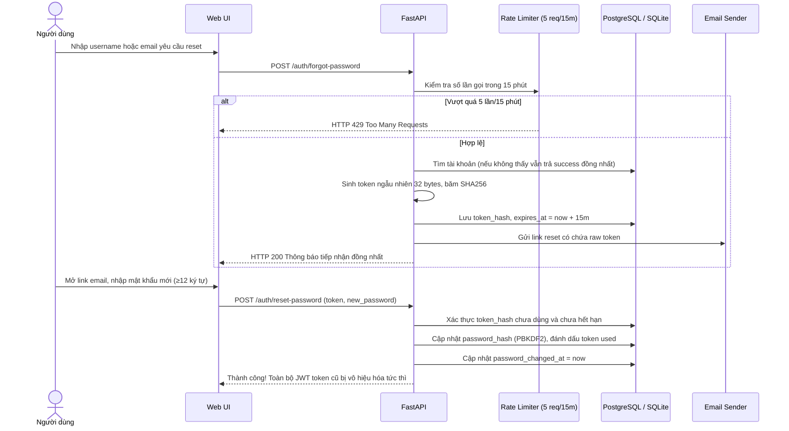
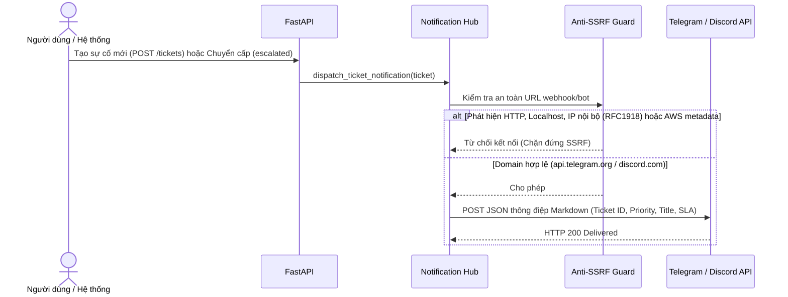
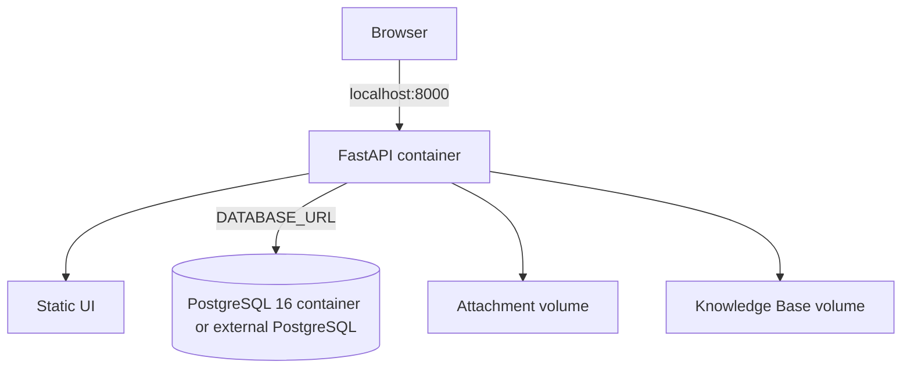
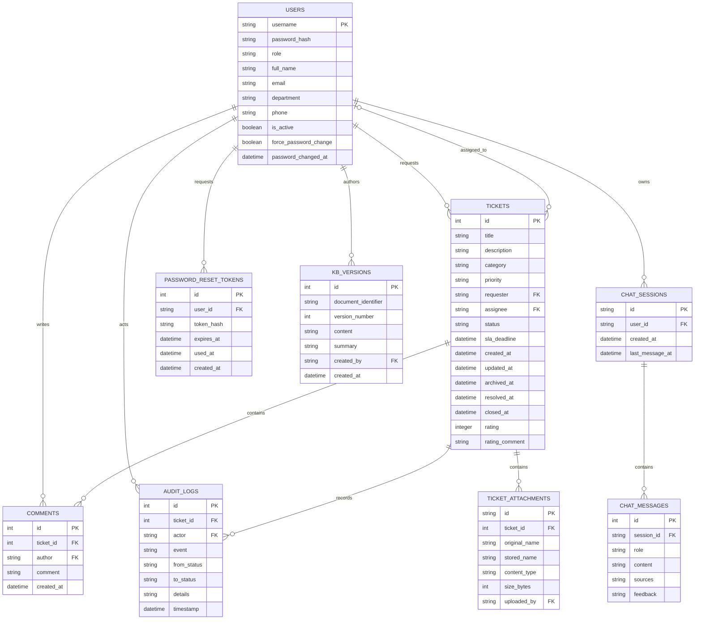

# Thiết kế phần mềm (SDD)

**Phiên bản:** 1.0 — khớp prototype hiện tại\
**Stack:** FastAPI, PostgreSQL cho Docker Compose hoặc SQLite cho local development/test, HTML/CSS/JavaScript tĩnh, bộ truy xuất BM25 tối giản.

## 1. Kiến trúc thành phần

```mermaid
flowchart LR
  Browser[Web UI: HTML/CSS/JS] -->|HTTP(S) / JSON API| API[FastAPI]
  API --> Auth[Auth + RBAC + Rate Limit]
  API --> Tickets[Ticket / SLA / Audit]
  API --> RAG[RAG Retrieval: BM25 + Synonyms]
  API --> KBMod[Knowledge Base: 2-stage Review & Versions]
  API --> Notify[Notification Hub: Telegram / Discord]
  API --> Email[Email Sender / Password Reset]
  Tickets --> DB[(PostgreSQL / SQLite)]
  Auth --> DB
  KBMod --> DB
  KBMod --> Markdown[Markdown Runbook Storage]
  Files[Local Attachment Storage] --> API
  RAG --> Markdown
  RAG -->|Trích đoạn + File nguồn| API
  Notify -->|HTTPS Allowlist / Anti-SSRF| ExtChannels[Telegram Bot & Discord Webhook]
```

Trong hệ thống, ứng dụng web và API chạy cùng FastAPI. `DATABASE_URL` chọn PostgreSQL (cho Docker Compose và Cloud Deployment Neon) hoặc SQLite (cho local test). Cơ sở dữ liệu lưu trữ người dùng, ticket, bình luận, audit log, attachment metadata, lịch sử hỏi đáp RAG, token đặt lại mật khẩu và lịch sử phiên bản Runbook. Phân hệ Notification Hub tích hợp Telegram Bot và Discord Webhook với lớp phòng thủ chống SSRF nghiêm ngặt. Phân hệ Email Sender hỗ trợ gửi link khôi phục mật khẩu tự phục vụ một lần. UI hỗ trợ song ngữ Việt - Anh lưu trong browser LocalStorage.

## 2. Sơ đồ ngữ cảnh



## 3. Sequence — gợi ý RAG và tạo ticket



## 4. Sequence — Agent tiếp nhận và xử lý



## 5. FSM trạng thái



## 6. Các quy trình nghiệp vụ chính

### 6.1. Quy trình quản trị tri thức & Kiểm duyệt 2 lớp



### 6.2. Quy trình khôi phục mật khẩu tự phục vụ qua Email



### 6.3. Quy trình thông báo sự cố đa kênh (Telegram & Discord)



## 7. Sơ đồ triển khai demo



Docker Compose chạy service PostgreSQL 16 và ứng dụng, bind web/API vào loopback `127.0.0.1:8000`; database, attachment và Knowledge Base có named volume riêng. App container chạy bằng UID không đặc quyền; healthcheck gọi `/health`. `DATABASE_URL` có thể trỏ PostgreSQL bên ngoài, nhưng Compose hiện vẫn khởi chạy service PostgreSQL cục bộ. Không có công cụ migration dữ liệu SQLite cũ sang PostgreSQL hoặc migration tổng quát cho PostgreSQL production sẵn có. Chưa có Nginx, worker, vector database, TLS, backup/restore tự động, HA hoặc cấu hình production.

## 8. Mô hình dữ liệu (ERD)



### Từ điển dữ liệu

| Bảng | Trường | Ý nghĩa / ràng buộc |
|---|---|---|
| `users` | `username` | Khóa chính; 3–50 ký tự, chữ/số/`._-`; được chuẩn hóa chữ thường khi tạo qua API |
| `users` | `password_hash` | PBKDF2-HMAC-SHA256 (180.000 vòng lặp), salt ngẫu nhiên; không trả qua API |
| `users` | `role` | Enum: `user` (Nhân viên), `agent` (Kỹ thuật viên) hoặc `admin` (Quản trị viên) |
| `users` | `full_name`, `email`, `department`, `phone`, `is_active` | Hồ sơ người dùng; `is_active=0` khóa tài khoản, chặn đăng nhập và phân công |
| `users` | `force_password_change` | Cờ bắt buộc đổi mật khẩu ở lần đăng nhập tiếp theo do Admin đặt lại |
| `users` | `password_changed_at` | Mốc thời gian đổi mật khẩu UTC; dùng đối soát để vô hiệu hóa JWT cấp trước mốc này (`pwd_at`) |
| `tickets` | `id` | Khóa chính tăng tự động |
| `tickets` | `requester`, `assignee` | Khóa ngoại tới `users`; `assignee` để trống hoặc trỏ tới Kỹ thuật viên/Admin |
| `tickets` | `title`, `description`, `category` | Tiêu đề (5–160), mô tả (10–5000), loại (2–50 ký tự) |
| `tickets` | `priority`, `status` | Enum ràng buộc: Priority (`low`, `medium`, `high`, `urgent`); Status (`new`, `in_progress`, `pending_waiting_user`, `resolved`, `closed`, `escalated`) |
| `tickets` | `resolved_at`, `closed_at`, `rating`, `rating_comment` | Mốc hoàn tất và đánh giá 1–5 sao của người tạo ticket |
| `tickets` | `sla_deadline` | Thời gian UTC; mục tiêu cam kết tính theo giờ lịch: 48h (Low), 24h (Medium), 8h (High), 2h (Urgent) |
| `tickets` | `created_at`, `updated_at`, `archived_at` | Mốc UTC ISO-8601; `archived_at` null khi hoạt động, có giá trị khi lưu trữ mềm |
| `comments` | `ticket_id`, `author` | Khóa ngoại; chuỗi trao đổi 2 chiều giữa nhân viên và IT |
| `audit_logs` | `ticket_id`, `actor`, `event` | Nhật ký bất biến; lưu tác nhân/thời gian/trạng thái cũ/mới; lưu trữ ticket không xóa log |
| `ticket_attachments` | `stored_name`, `content_type`, `size_bytes` | Tệp PNG/JPG/TXT/LOG tối đa 10 MiB; tên lưu trữ UUID ngẫu nhiên; download qua API xác thực |
| `chat_sessions`, `chat_messages` | `user_id`, `session_id`, `sources`, `feedback` | Lịch sử tra cứu giới hạn theo chủ phiên; feedback 👍 / 👎 phục vụ tinh chỉnh tri thức |
| `password_reset_tokens` | `token_hash`, `expires_at`, `used_at` | Token đặt lại mật khẩu ngẫu nhiên băm SHA256; hạn sử dụng 15 phút; dùng một lần |
| `kb_versions` | `document_identifier`, `version_number`, `summary` | Lịch sử phiên bản Runbook (v1, v2...); hỗ trợ đối soát thay đổi và khôi phục (Restore) |

---

## 9. API chính

| Method | Endpoint | Quyền hạn | Mục đích & Nghiệp vụ |
|---|---|---|---|
| GET | `/config` | Công khai | Trả cờ `demo_mode` để giao diện hiển thị thông tin mẫu hỗ trợ kiểm thử |
| POST | `/auth/login` | Công khai | Đăng nhập; cấp JWT token; rate limit 5 lần sai/15 phút; dummy hash chống timing attack |
| GET | `/auth/me` | Đã đăng nhập | Lấy đầy đủ hồ sơ người dùng (họ tên, email, phòng ban, điện thoại, ngày đổi MK) và thống kê hoạt động vé cá nhân |
| PATCH | `/auth/profile` | Đã đăng nhập | Người dùng tự cập nhật thông tin liên hệ cá nhân (họ tên, email có kiểm tra cú pháp, phòng ban, số điện thoại) |
| POST | `/auth/change-password` | Đã đăng nhập | Người dùng đổi mật khẩu chủ động; yêu cầu mật khẩu cũ, mật khẩu mới $\ge$ 12 ký tự |
| POST | `/auth/forgot-password` | Công khai | Yêu cầu link reset mật khẩu qua email; rate limit 5 req/15m; phản hồi đồng nhất |
| POST | `/auth/reset-password` | Công khai | Đặt lại mật khẩu bằng token email; hủy token và vô hiệu hóa JWT cũ |
| GET | `/staff` | Agent / Admin | Danh sách nhân sự IT khả dụng để phân công ticket |
| GET | `/admin/users` | Admin | Danh sách toàn bộ người dùng và vai trò; không lộ hash mật khẩu |
| POST | `/admin/users` | Admin | Tạo tài khoản mới; kiểm tra mật khẩu $\ge$ 12 ký tự |
| PATCH | `/admin/users/{username}` | Admin | Chỉnh sửa hồ sơ, vai trò, khóa/mở khóa; chặn tự khóa hoặc khóa Admin duy nhất |
| POST | `/admin/users/{username}/reset-password` | Admin | Đặt lại mật khẩu nhân viên kèm cờ `force_password_change` |
| GET | `/admin/notifications/status` | Admin | Xem trạng thái cấu hình Telegram Bot & Discord Webhook (che mờ token) |
| POST | `/admin/notifications/test` | Admin | Bắn thông báo thử nghiệm tới Telegram hoặc Discord có kiểm tra chống SSRF |
| GET | `/tickets` | Đã đăng nhập | Xem danh sách ticket (User chỉ xem vé của mình; IT xem toàn bộ hàng đợi) |
| POST | `/tickets` | Đã đăng nhập | Tạo ticket mới; tự động tính `sla_deadline` và ghi Audit Log |
| GET | `/tickets/{id}` | Chủ vé / IT | Xem chi tiết sự cố, tiến trình SLA và chuỗi trao đổi |
| PUT | `/tickets/{id}` | Chủ vé (`new`) / IT | Cập nhật thông tin ticket; tự động tính lại SLA nếu thay đổi Mức độ ưu tiên |
| PATCH | `/tickets/{id}` | Agent / Admin / Chủ vé | Chuyển đổi trạng thái FSM hoặc đóng/mở lại ticket đã giải quyết |
| DELETE | `/tickets/{id}` | Admin | Lưu trữ mềm ticket (soft archive); giữ nguyên toàn bộ Audit Log |
| PUT | `/tickets/{id}/assignment` | Agent / Admin | Nhận hoặc chuyển giao ticket cho Kỹ thuật viên phụ trách |
| POST | `/tickets/{id}/comments` | Chủ vé / IT | Thêm bình luận trao đổi; người tạo bình luận tự động đưa vé chờ về `in_progress` |
| POST | `/tickets/{id}/attachments` | Chủ vé / IT | Tải lên tệp chẩn đoán (PNG, JPG, TXT, LOG $\le$ 10 MiB) |
| GET | `/tickets/{id}/attachments/{aid}` | Chủ vé / IT | Tải về tệp đính kèm an toàn qua xác thực quyền truy cập |
| POST | `/tickets/{id}/rate` | Chủ vé | Đánh giá sao CSAT (1–5 sao) và phản hồi sau khi ticket được giải quyết |
| GET | `/tickets/{id}/audit` | Chủ vé / IT | Xem nhật ký kiểm toán bất biến theo thời gian của ticket |
| GET | `/analytics` | Agent / Admin | Bảng điều khiển phân tích tổng quan: SLA compliance, CSAT, phân bố danh mục |
| GET | `/analytics/agents/me` | Agent / Admin | Báo cáo hiệu suất cá nhân của chính Kỹ thuật viên (vé được giao, SLA cá nhân) |
| GET | `/analytics/export` | Admin | Xuất dữ liệu báo cáo sự cố toàn diện dưới định dạng CSV |
| GET | `/knowledge` | Đã đăng nhập | Danh sách tài liệu Runbook (User chỉ xem `published`; IT xem cả bản nháp) |
| POST | `/knowledge` | Admin | Nạp tệp Runbook Markdown mới (kiểm tra UTF-8, tiêu đề H1, dung lượng $\le$ 256 KiB) |
| GET | `/knowledge/{identifier}` | Đã đăng nhập | Xem nội dung chi tiết của một tài liệu Runbook |
| PUT | `/knowledge/{identifier}` | Agent / Admin | Cập nhật nội dung Runbook; Agent gửi duyệt (`pending_review`); Admin lưu trực tiếp |
| POST | `/knowledge/{identifier}/review` | Admin | Phê duyệt (`published`) hoặc trả lời từ chối bản nháp Runbook kèm ghi chú |
| GET | `/knowledge/{identifier}/versions` | Agent / Admin | Xem lịch sử các phiên bản sửa đổi (v1, v2...) của tài liệu Runbook |
| POST | `/knowledge/{identifier}/restore/{version}` | Admin | Khôi phục nội dung tài liệu về một phiên bản lịch sử cụ thể |
| DELETE | `/knowledge/{source}` | Admin | Xóa tài liệu Runbook tự tạo (bảo vệ các Runbook chuẩn mặc định hệ thống) |
| POST | `/knowledge/{source}/reindex` | Admin | Làm mới bộ chỉ mục tìm kiếm BM25 của tài liệu |
| POST | `/rag/ask` | Đã đăng nhập | Tra cứu tri thức tự phục vụ BM25; trích dẫn nguồn; trả thông báo từ chối an toàn |
| GET | `/rag/sessions` | Đã đăng nhập | Xem danh sách các phiên hỏi đáp trợ lý RAG của chính người dùng |
| GET | `/rag/sessions/{session_id}` | Đã đăng nhập | Xem chi tiết chuỗi hội thoại trong một phiên hỏi đáp cụ thể |
| POST | `/rag/feedback` | Đã đăng nhập | Gửi phản hồi đánh giá hữu ích 👍 hoặc không hữu ích 👎 cho câu trả lời |
| GET | `/health` | Công khai | Kiểm tra tình trạng kết nối CSDL và sức khỏe của hệ thống |

## 10. An toàn, lỗi và giới hạn

- Mật khẩu mẫu được lưu bằng PBKDF2; JWT dùng secret cấu hình qua biến môi trường.
- Demo tự sinh secret ngẫu nhiên khi không cấu hình; chế độ non-demo yêu cầu secret và bootstrap admin. Nếu DB vẫn chứa credential mẫu chưa đổi, startup non-demo chủ động từ chối để không vô tình dùng lại tài khoản demo. Chỉ dùng tài khoản mẫu ở local.
- Trước khi triển khai thật vẫn cần bật HTTPS, quản lý secret an toàn, rate limit, backup/restore, rà soát phụ thuộc và kiểm thử bảo mật theo môi trường.
- Các thao tác ghi cơ sở dữ liệu dùng parameter binding và foreign key.
- Tệp đính kèm có allow-list phần mở rộng, tên lưu trữ ngẫu nhiên, giới hạn dung lượng, quyền download và `X-Content-Type-Options: nosniff`; chưa có antivirus scan, quota tổng hoặc retention automation.
- SQL động cho bộ lọc/cập nhật chỉ ghép tên trường nội bộ từ danh sách cho phép; mọi giá trị truy vấn vẫn bind parameter.
- BM25 và synonym map chỉ là baseline; điểm relevance không phải xác suất độ đúng.
- Response `/rag/ask` kèm `triage`: danh mục theo source đứng đầu và ưu tiên heuristic theo các cụm từ tác động rõ ràng. Web hiển thị lý do và chỉ điền vào form khi người dùng chọn chuyển tiếp; mọi giá trị còn sửa được trước submit. Đây không phải dự đoán ML/chẩn đoán hay SLA được đơn vị nghiệp vụ phê duyệt.
- SQLite phù hợp development/test đơn máy; Docker Compose dùng PostgreSQL persistent. Chưa có kết quả thử tải/HA hoặc bằng chứng vận hành production.
