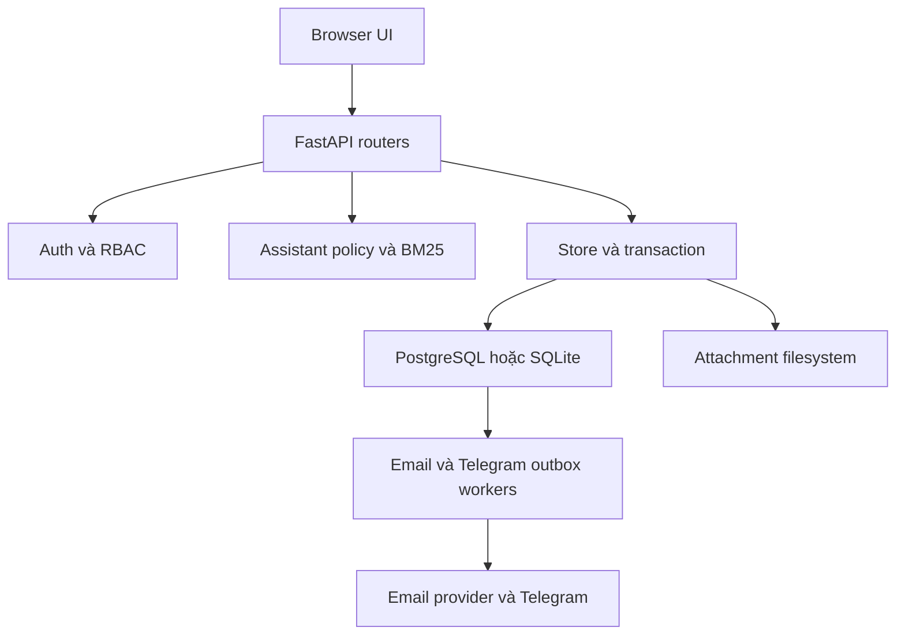
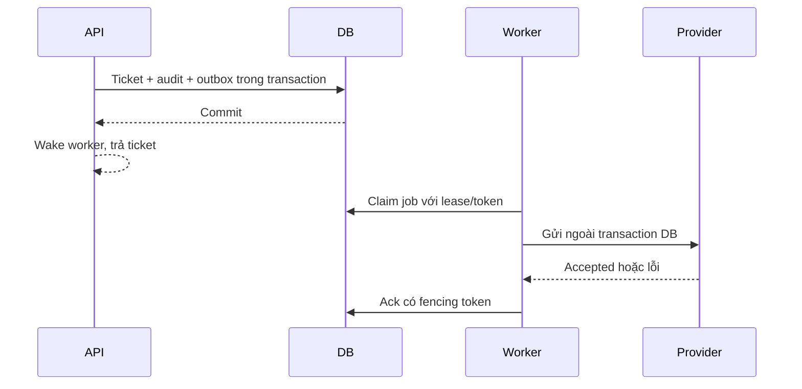
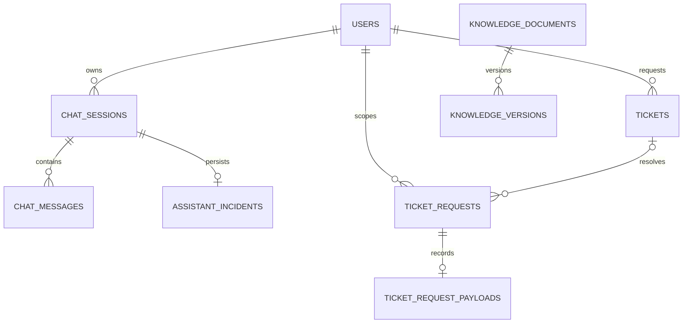

# Thiết kế phần mềm (SDD)

Phiên bản 1.1 — đồng bộ code ngày 31/10/2026. Tài liệu mô tả implementation hiện hành, không xác nhận deployment production hoặc kết quả kiểm thử. Lịch sử mô tả và các bản vá được giữ trong [snapshot SDD cũ](history/SDD_before_2026-10-31.md); các phát biểu trong snapshot có thể đã bị thay thế.

## 1. Phạm vi và ranh giới

OpsMind là ứng dụng FastAPI phục vụ đồng thời UI HTML/CSS/JavaScript và JSON API. Các router nằm trong `app/routers/`; nghiệp vụ lưu trữ tập trung trong `app/store.py`; xác thực/quyền trong `app/dependencies.py`; truy xuất trong `app/rag.py`; policy trợ lý trong `app/assistant_policy.py`. Đây là một ứng dụng triển khai chung, chưa có ranh giới microservice.

Không có vector database. BM25, synonym map và relevance score là cơ chế retrieval, không phải xác suất câu trả lời đúng. Cấu hình LLM tùy chọn nằm trong `app/config.py`/`app/rag.py`; có API key có thể tự bật generation nếu không đặt `ENABLE_LLM_GENERATION`. Deployment cần cấu hình tường minh, không suy từ tên RAG rằng LLM đã được sử dụng.

## 2. Cấu hình và triển khai

- `DATABASE_URL` không rỗng chọn PostgreSQL; rỗng chọn SQLite qua `HELPDESK_DB_PATH`. Không tự chuyển sang SQLite khi PostgreSQL lỗi và không tự migration dữ liệu giữa hai backend.
- `HELPDESK_STORAGE_PATH` là gốc lưu attachment. Metadata attachment nằm trong DB; filesystem và DB không có transaction phân tán.
- Docker chạy UID/GID 10001, Uvicorn bind `0.0.0.0`, port `${PORT:-8000}`. Docker healthcheck hiện gọi port 8000; khi dùng port khác phải đối chiếu probe của nền tảng.
- Docker Compose có PostgreSQL 16, Mailpit và app. Chỉ có hai named volume: `postgres-data` và `helpdesk-runtime`; không có volume KB riêng. App publish tại `127.0.0.1:8000`.
- `render.yaml` là Blueprint đề xuất: web Docker Starter, Singapore, một instance, disk 1 GB mount `/app/runtime`, DB SQLite fallback trên disk, `DATABASE_URL` nhập riêng cho Neon/PostgreSQL. Blueprint tự sinh secret và bootstrap password; tắt demo, TTL JWT 120 phút.
- Blueprint không chứng minh cấu hình live. UID quyền ghi disk, durability qua redeploy, restore backup, PostgreSQL runtime và thông tin mail phải được nghiệm thu riêng. Không có HA, object storage, backup automation hoặc migration tổng quát được mô tả là đã hoàn tất.

## 3. Xác thực và phiên

User có ba role `user`, `agent`, `admin`. JWT được kiểm hạn, role, active, `pwd_at` và `session_epoch` với dữ liệu DB. Epoch đổi cùng transaction khi đổi/reset password, thay role/active; logout thu hồi có điều kiện theo epoch gửi lên. Không có refresh token, per-device session hoặc hủy request đã qua auth.

Non-demo bắt buộc `SECRET_KEY` có ít nhất 32 ký tự, không rỗng/toàn khoảng trắng và không thuộc danh sách key mẫu yếu. Thiếu key làm startup thất bại. Chỉ demo được tự sinh key khi thiếu. Key production phải được giữ ổn định qua restart và giữa worker vì dùng cho JWT và HMAC token email.

Mật khẩu tối thiểu 12 ký tự theo policy và ngoại lệ demo tường minh; PBKDF2-HMAC-SHA256 với salt. Bootstrap admin và credential mẫu được kiểm riêng trong store. Rate limit lưu DB; đây không phải bảo đảm chống mọi tải độc hại.

## 4. Thực thi và health

Endpoint đồng bộ chạy trong threadpool FastAPI. Async KB upload offload xác thực và DB persistence. `/health` GET/HEAD kiểm DB bằng `SELECT 1` qua `run_in_threadpool`: thành công trả 200, lỗi `store.DatabaseError` trả 503 chung. `/config` không I/O và trả cờ demo. DB chậm vẫn làm chính health request chờ; offload không tạo timeout DB hoặc tăng capacity threadpool.

Worker email, notification và cleanup rate limit chạy trong lifespan mỗi process; thao tác đồng bộ được offload. Đây là worker trong process, không phải service worker Render riêng. Threadpool dùng chung, chưa có kết quả tải chứng minh throughput.

## 5. Trợ lý, retrieval và tri thức

Nguồn retrieval production là `knowledge_documents` có trạng thái `published` trong DB. File Markdown đóng gói chỉ là nguồn seed; loader không đọc filesystem để cứu khi DB rỗng/lỗi. Override `KNOWLEDGE_DIR` trong Python chỉ phục vụ fixture/offline evaluation.

Mỗi retrieval đọc snapshot published hiện hành. Cache chunk/tokenization theo nội dung đầy đủ, tối đa một snapshot/process; archive/edit/publish đổi khóa. Request đã đọc snapshot trước mutation có thể hoàn tất với dữ liệu cũ. Lỗi kho tri thức trả 503, không dùng cache cũ thay DB lỗi.

Policy trợ lý có phạm vi đầu tiên là mạng dây và máy in Offline. Incident context được lưu theo session, có revision để phát hiện cập nhật cạnh tranh. Đổi sự cố cần xác nhận; attempted, resolved và useful feedback là ba tín hiệu khác nhau. Chỉ bước thuộc catalogue approved, đúng dữ kiện và role mới được hướng dẫn. Catalogue thật `data/assistant_runbooks.json` hiện rỗng; không được coi published KB là phê duyệt bước trợ lý.

Nhánh policy có thể trả câu hỏi hoặc bàn giao trước retrieval. Retrieval có matches nhưng chưa qua catalogue bị chuyển sang `IN_SCOPE_NO_SOURCE`, không phát lại thủ tục không được duyệt. Khi policy áp dụng, response xóa nguồn/matches retrieval và dùng `incident_triage`: printer → hardware, network → network, còn lại general; priority tạm thời medium. Không dùng danh mục BitLocker hoặc ưu tiên heuristic của nguồn bị bác bỏ. Nhánh retrieval không qua policy cần được phân biệt khi mô tả triage.

Chi tiết trạng thái và tiêu chí: [ASSISTANT_SPEC_V1.md](ASSISTANT_SPEC_V1.md). Bằng chứng và giới hạn: [ASSISTANT_DIAGNOSTICS.md](ASSISTANT_DIAGNOSTICS.md).

## 6. Ticket, SLA và idempotency

User chỉ xem ticket của mình; staff xử lý theo RBAC. Trạng thái gồm new, in_progress, pending_waiting_user, resolved, closed, escalated; ma trận chuyển trạng thái và quyền cụ thể trong schemas/store/router. Không xem một sơ đồ happy-path là toàn bộ FSM. SLA dùng giờ lịch: low 48, medium 24, high 8, urgent 2; không tự tạo cảnh báo quá hạn.

Các writer trạng thái, assignment, comment, edit, archive và CSAT dùng transaction/lock thích hợp. SQLite dùng BEGIN IMMEDIATE, PostgreSQL khóa row. `expected_status` phát hiện status khác snapshot; không phải revision cho mọi field và không phát hiện A→B→A. Assignment bị chặn khi resolved/closed; rating chỉ một lần theo owner và completed state. Audit cùng transaction.

`POST /tickets` nhận `request_key` tùy chọn 16–64 ký tự. Khóa theo `(requester, request_key)`; payload được ghi bất biến, replay cùng payload trả ticket cũ, khác payload trả 409. Claim, ticket, audit và outbox cùng transaction. Không gửi key thì không có bảo đảm chống tạo trùng theo request.

`GET /ticket-requests/{request_key}` chỉ tra cứu cho chính người gửi. UI assistant giữ key và lookup trước khi retry mất response; chỉ 404 mới tạo lại. Đây là idempotency tạo ticket, khác at-least-once delivery của notification. Biên nhận ticket không xác nhận IT đã đọc hoặc nhận việc.

## 7. KB authoring và version

List/get/reindex/delete dùng DB. Tài liệu có draft, pending_review, approved, published, archived theo quyền router/store; user chỉ xem published. Admin kiểm duyệt; Agent gửi duyệt theo policy. Multipart import chuẩn UTF-8/H1, tối đa 256 KiB và JSON editor đều ghi document + version trong cùng transaction. Không ghi file Markdown runtime.

Update/review/restore khóa document, tăng version sau khóa; unique `(document_id, version_number)` bảo vệ trùng. Partial updates được serialize, không có optimistic revision cho KB. Builtin bị chặn xóa theo policy. Lỗi mất response sau commit không chứng minh write thất bại; cần đối chiếu slug/version trước retry.

## 8. Thông báo và email

Ticket mới và chuyển cấp hợp lệ tạo một delivery Telegram/event. Không có email ticket, tự tăng priority hay SLA alert. Schema còn chấp nhận giá trị Discord lịch sử nhưng enqueue/claim hiện chỉ Telegram. Provider accepted không phải delivered-to-reader hoặc IT acknowledgment.

Notification claim dùng lease 120s, tối đa 3 lần mỗi chu kỳ, retry sau 5s/10s, poll 5s và batch tối đa 10. Admin có API retry trạng thái cho phép. Crash sau send trước DB ack có thể gửi trùng: at-least-once, không exactly-once.

Credential email có queue `email_deliveries` riêng. Tạo user/invitation hoặc forgot-password ghi job và hash token trong transaction. Raw token derive HMAC-SHA256 từ secret, UUID job, kind, username, epoch; không lưu raw token/body/password. Trước gửi kiểm active/email/epoch/token expiry và config fingerprint. Claim/lease/retry tương tự, provider accepted hoặc demo mocked là terminal. Không gia hạn TTL khi retry.

Reset token được kiểm/consume cùng transaction cập nhật password, epoch và thu hồi token còn lại; token một lần, TTL 15 phút. Thay email/active/password thu hồi link theo policy; không thể recall email đã in-flight. Diagnostics mail test là one-shot. Cấu hình provider rỗng có auto-detection, không chứng minh mail thật hoạt động.

## 9. Mô hình dữ liệu

Tên bảng/cột dưới đây là tên implementation. Schema và migration tương thích nằm trong `store.initialize_store`, `notification_outbox.initialize`, `email_outbox.initialize`.

| Bảng | Khóa và liên kết chính |
|---|---|
| users | username PK; password_hash, role, active, password_changed_at, session_epoch |
| tickets | id PK; requester/assignee → users; trạng thái, SLA, timestamps, rating |
| comments / audit_logs | ticket_id → tickets; author/actor → users |
| ticket_attachments | id PK; ticket_id; stored_name, content_type, size_bytes; bytes trên disk |
| chat_sessions / chat_messages | session id; user_id → users; messages.session_id → sessions |
| assistant_incidents | session_id PK/FK → chat_sessions; context JSON dạng text, gồm revision |
| ticket_requests | PK requester + request_key; ticket_id → tickets |
| ticket_request_payloads | PK/FK requester + request_key → ticket_requests; payload bất biến |
| knowledge_documents | id PK; slug unique; content, status, author, reviewer, is_builtin |
| knowledge_versions | document_id → knowledge_documents; version_number, change_summary, author |
| password_reset_tokens | username → users; token_hash unique, expires_at, used (0/1), created_at |
| rate_limit_attempts | id PK; key, attempt_time |
| notification_outbox | event/ticket/channel, snapshot, state, attempts, lease, target fingerprint |
| email_deliveries | user/recipient/kind, token hash, state, attempts, lease, config fingerprint |

ERD rút gọn cho dữ liệu trợ lý và KB; các field không liệt kê không có nghĩa là không tồn tại:

## 10. API và giới hạn kiểm chứng

API contract đầy đủ lấy từ router và OpenAPI ứng dụng (`/openapi.json`). Các nhóm chính: `/auth`, `/tickets`, `/ticket-requests`, `/knowledge`, `/rag`, `/analytics`, `/admin`, `/health`, `/config`. Không duy trì một bảng endpoint rút gọn như thể đó là toàn bộ hợp đồng.

Attachment chỉ PNG/JPG/TXT/LOG tối đa 10 MiB, download có xác thực và nosniff; chưa có antivirus/quota tổng/retention automation. Chưa giải quyết mọi race last-active-admin, bootstrap đồng thời hoặc atomicity file/DB. Không có bằng chứng production HA, throughput, backup restore hay nghiệm thu độc lập chỉ từ việc unit test pass.

## 11. Quyết định ngày 31/10/2026

Người dùng đã chốt: SDD là mô tả implementation hiện hành; lịch sử tách riêng; non-demo thiếu secret phải fail startup; health giữ DB check nhưng offload khỏi event loop. Không thay kiến trúc triển khai hoặc tự deploy Render. Không thêm ADR cho thay đổi nhỏ dễ đảo ngược; không tạo glossary khi chưa có thuật ngữ nghiệp vụ mới cần thống nhất.
