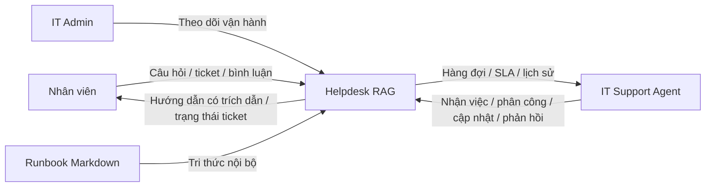
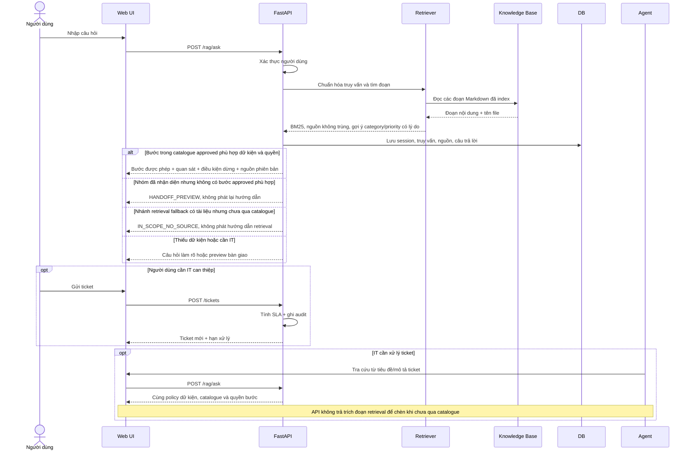
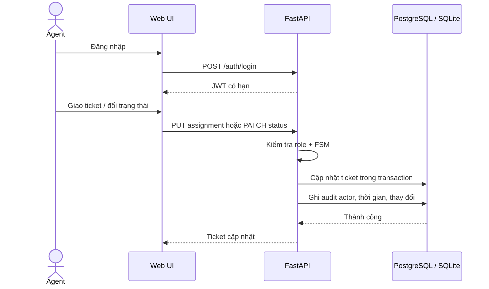
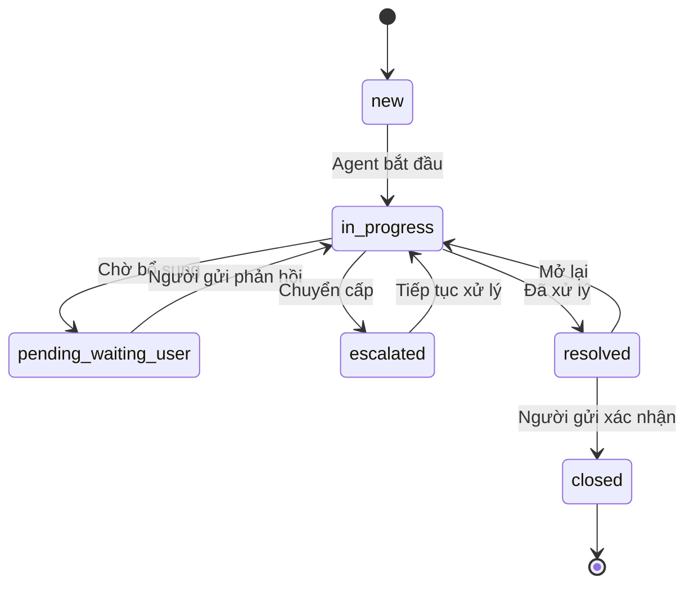
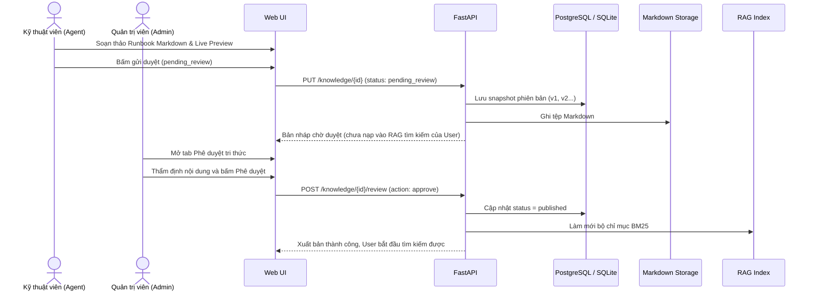
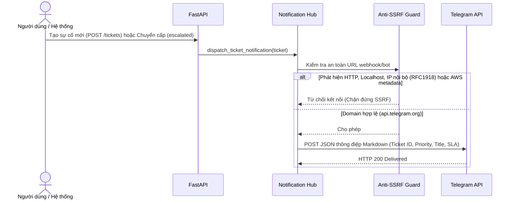
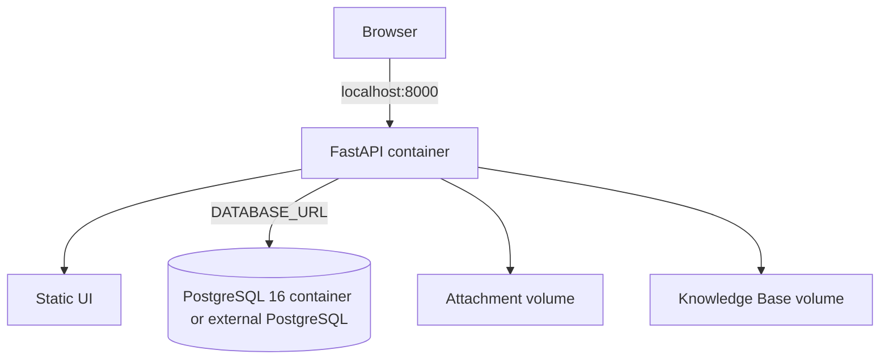
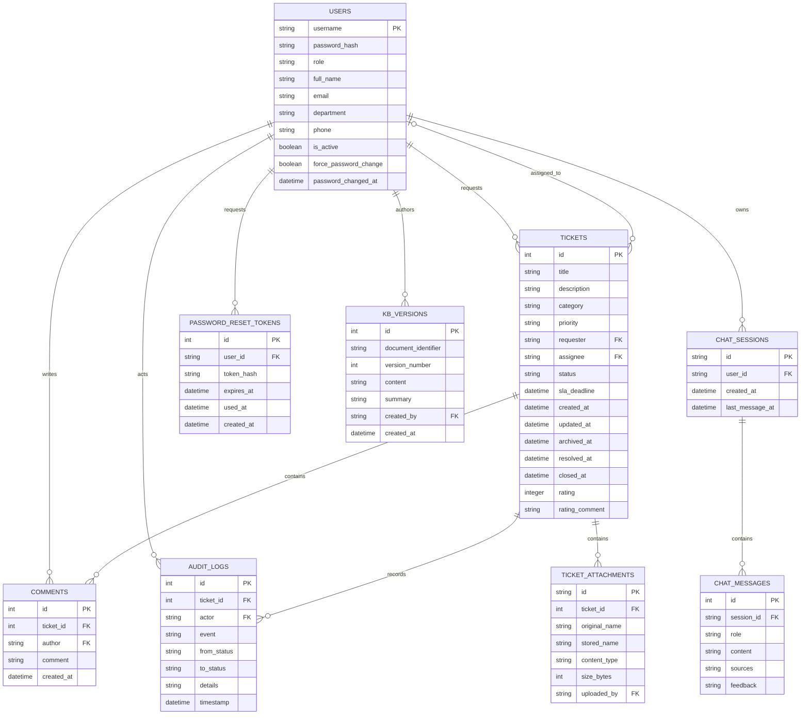

# Thiết kế phần mềm (SDD)

**Phiên bản:** 1.0 — khớp prototype hiện tại\
**Stack:** FastAPI, PostgreSQL cho Docker Compose hoặc SQLite cho local development/test, HTML/CSS/JavaScript tĩnh, bộ truy xuất BM25 tối giản.

## 1. Kiến trúc thành phần

```mermaid
flowchart LR
  Browser[Web UI: HTML/CSS/JS] -->|HTTP(S) / JSON API| API[FastAPI]
  API --> Auth[Auth + RBAC + Rate Limit]
  API --> Tickets[Ticket / SLA / Audit]
  API --> RAG[RAG Retrieval: BM25 + Synonyms]
  API --> KBMod[Knowledge Base: 2-stage Review & Versions]
  API --> Notify[Notification Hub: Telegram]
  API --> Email[Email Sender / Password Reset]
  Tickets --> DB[(PostgreSQL / SQLite)]
  Auth --> DB
  KBMod --> DB
  KBMod --> Markdown[Markdown Runbook Storage]
  Files[Local Attachment Storage] --> API
  RAG --> Markdown
  RAG -->|Trích đoạn + File nguồn| API
  Notify -->|HTTPS Allowlist / Anti-SSRF| ExtChannels[Telegram Bot]
```

Trong hệ thống, ứng dụng web và API chạy cùng FastAPI. `DATABASE_URL` chọn PostgreSQL (cho Docker Compose và Cloud Deployment Neon) hoặc SQLite (cho local test). Cơ sở dữ liệu lưu trữ người dùng, ticket, bình luận, audit log, attachment metadata, lịch sử hỏi đáp RAG, token đặt lại mật khẩu và lịch sử phiên bản Runbook. Phân hệ Notification Hub tích hợp Telegram Bot với lớp phòng thủ chống SSRF nghiêm ngặt. Phân hệ Email Sender hỗ trợ gửi link khôi phục mật khẩu tự phục vụ một lần. UI hỗ trợ song ngữ Việt - Anh lưu trong browser LocalStorage.

## 2. Sơ đồ ngữ cảnh



## 3. Sequence — gợi ý RAG và tạo ticket



Chi tiết policy hiện hành xem [ASSISTANT_DIAGNOSTICS.md](ASSISTANT_DIAGNOSTICS.md). Sơ đồ biểu diễn các nhánh logic; policy có thể trả câu hỏi/bàn giao trước khi gọi retriever. Catalogue thật hiện rỗng; chưa có hướng dẫn được chuyên gia phê duyệt.

### Nguồn tri thức và trạng thái xuất bản (AUD-05)

Ở cấu hình mặc định, `app/rag.py` nạp duy nhất tài liệu `published` từ DB rồi tạo retrieval index. Danh sách published rỗng là trạng thái hợp lệ: RAG trả `grounded=false`, không có matches/sources và đề nghị tạo ticket. Không đọc lại runbook gốc hoặc tài liệu runtime từ filesystem khi kho DB rỗng hoặc lỗi. Runbook mặc định vẫn được seed vào DB lúc khởi tạo; các dòng đã tồn tại với trạng thái archived không được xuất bản lại bởi loader.

Nếu truy vấn kho tri thức lỗi, loader phát sinh `KnowledgeBaseUnavailableError`; `POST /rag/ask` trả HTTP 503 với thông báo chung, không lưu chat exchange từ lần gọi thất bại. Exception không bị cache nên lần gọi sau có thể thử lại khi DB phục hồi. Từ AUD-08, mỗi retrieval đều đọc trạng thái xuất bản hiện hành, kể cả khi index trong process đã nóng; lỗi đọc KB không được thay bằng kết quả cache cũ.

Nhánh đọc filesystem chỉ còn khi code chủ động override `KNOWLEDGE_DIR` sang thư mục khác, phục vụ fixture/thử nghiệm cách ly; không phải cơ chế failover hoặc một tùy chọn cấu hình production mới.

### Tính nhất quán giữa worker (AUD-08)

Không cache lâu dài danh sách tài liệu từ DB. Mỗi lần dựng/lấy index đều đọc tập `published` hiện hành, chuẩn hóa thứ tự theo source rồi tạo khóa immutable gồm title, source, category, tags và content. Chỉ phần chunk/tokenize được cache theo khóa nội dung đầy đủ này với tối đa một snapshot trong mỗi process. Nội dung không đổi thì tái sử dụng index; edit, archive, review, restore, delete hoặc publish thay đổi tập dữ liệu và tự chọn index tương ứng, không phụ thuộc process nhận mutation gọi cache_clear.

Các hook `load_knowledge_base.cache_clear()` và `build_retrieval_index.cache_clear()` hiện có được giữ để clear cache index, gồm khi reload dictionary/reindex. Không thêm schema, revision table, TTL hoặc dịch vụ cache. Đổi lại, mỗi retrieval cần đọc DB; kết quả cache nóng không được phục vụ khi đọc KB lỗi.

Cam kết là snapshot của lần đọc DB: retrieval bắt đầu đọc sau commit sẽ thấy trạng thái đã commit. Request đã đọc snapshot trước mutation có thể hoàn tất với dữ liệu trước mutation; không hủy hoặc thu hồi câu trả lời đang xử lý hay hội thoại lịch sử. Local kiểm process API và process đọc Python riêng, cùng SQLite, đã warm trước mutation; chưa phải kiểm deployment nhiều Uvicorn worker qua load balancer. PostgreSQL có test tương ứng trong CI, chưa chạy runtime local. Dictionary cấu hình toàn cục của worker không thuộc cơ chế đồng bộ tài liệu này.

## 4. Sequence — Agent tiếp nhận và xử lý



## 5. FSM trạng thái



## 6. Các quy trình nghiệp vụ chính

### 6.1. Quy trình quản trị tri thức & Kiểm duyệt 2 lớp



### 6.2. Quy trình khôi phục mật khẩu tự phục vụ qua Email

```mermaid
sequenceDiagram
  actor U as Người dùng
  participant UI as Web UI
  participant API as FastAPI
  participant RL as Rate Limiter (5 req/15m)
  participant DB as PostgreSQL / SQLite
  participant Mail as Email Sender

  U->>UI: Nhập username hoặc email yêu cầu reset
  UI->>API: POST /auth/forgot-password
  API->>RL: Kiểm tra số lần gọi trong 15 phút
  alt Vượt quá 5 lần/15 phút
    RL-->>UI: HTTP 429 Too Many Requests
  else Hợp lệ
    API->>DB: Tìm tài khoản (nếu không thấy vẫn trả success đồng nhất)
    API->>API: Sinh token ngẫu nhiên 32 bytes, băm SHA256
    API->>DB: Lưu token_hash, expires_at = now + 15m
    API->>Mail: Gửi link reset có chứa raw token
    API-->>UI: HTTP 200 Thông báo tiếp nhận đồng nhất
  end

  U->>UI: Mở link email, nhập mật khẩu mới (≥12 ký tự)
  UI->>API: POST /auth/reset-password (token, new_password)
  rect rgb(240, 245, 255)
    API->>DB: Bắt đầu transaction, khóa writer SQLite hoặc hàng user PostgreSQL
    API->>DB: Đọc lại token, kiểm hạn/active/password epoch
    API->>DB: Claim token bằng UPDATE used=1 WHERE used=0, yêu cầu đúng 1 row
    API->>DB: Cập nhật password_hash, password_changed_at, force flag
    API->>DB: Thu hồi các reset token chưa dùng còn lại của user
  end
  API->>DB: COMMIT khi thành công; lỗi ghi => ROLLBACK toàn bộ
  API-->>UI: Thành công! Toàn bộ JWT token cũ bị vô hiệu hóa tức thì
```

Liên kết reset đã cấp được thu hồi trong cùng transaction khi cập nhật mật khẩu, gồm đổi chủ động, Admin reset và reset bằng token. Đổi địa chỉ email thực sự hoặc chuyển trạng thái active/inactive cũng thu hồi token chưa dùng của tài khoản trong transaction cập nhật profile. Cập nhật tên hiển thị, giữ nguyên trạng thái active hoặc chỉ thay hoa/thường/khoảng trắng của cùng email không thu hồi token. Việc thu hồi không tác động token của tài khoản khác; token mới sau thay đổi vẫn dùng được một lần.

AUD-06 dùng cơ chế đánh dấu `used` và đối chiếu `created_at` của token với `password_changed_at` để từ chối cả liên kết cũ tồn tại trước bản vá; không thêm cột/schema mới. Vòng đời JWT khi khóa/mở khóa tài khoản thuộc AUD-15, chưa được giải quyết bởi việc thu hồi reset token.

AUD-07 đưa verify/consume token, cập nhật mật khẩu/epoch/force flag và thu hồi link còn lại vào một connection/transaction. SQLite dùng `BEGIN IMMEDIATE` trước khi đọc trạng thái; PostgreSQL dùng `SELECT ... FOR UPDATE` trên hàng user. Token được đọc lại sau khi có khóa và claim bằng UPDATE có điều kiện `used=0`, kiểm `rowcount == 1`. Lỗi ghi làm rollback cả token lẫn mật khẩu; không gọi hai public store function mở transaction riêng trong luồng reset nữa.

Cấp link, đổi mật khẩu trực tiếp và reset đều khóa user trước khi đụng hàng token trên PostgreSQL. Mốc phát hành/hết hạn link được tính sau khi lấy khóa, tránh link mới có thời điểm tạo cũ hơn lần đổi mật khẩu vừa commit. SQLite khóa writer cho toàn DB trong transaction này; test local kiểm hai connection đồng thời ở DELETE và WAL, không phải benchmark tải. Nhánh PostgreSQL có test concurrency/rollback trong CI nhưng chưa có runtime local. Lookup email của request forgot-password và gửi email vẫn nằm ngoài transaction; không coi mọi race liên quan địa chỉ nhận email là đã được giải quyết.

### 6.3. Quy trình thông báo sự cố đa kênh (Telegram)



## 7. Sơ đồ triển khai demo



Docker Compose chạy service PostgreSQL 16 và ứng dụng, bind web/API vào loopback `127.0.0.1:8000`; database, attachment và Knowledge Base có named volume riêng. App container chạy bằng UID không đặc quyền; healthcheck gọi `/health`. `DATABASE_URL` có thể trỏ PostgreSQL bên ngoài, nhưng Compose hiện vẫn khởi chạy service PostgreSQL cục bộ. Không có công cụ migration dữ liệu SQLite cũ sang PostgreSQL hoặc migration tổng quát cho PostgreSQL production sẵn có. Chưa có Nginx, worker, vector database, TLS, backup/restore tự động, HA hoặc cấu hình production.

## 8. Mô hình dữ liệu (ERD)



### Từ điển dữ liệu

| Bảng | Trường | Ý nghĩa / ràng buộc |
|---|---|---|
| `users` | `username` | Khóa chính; 3–50 ký tự, chữ/số/`._-`; được chuẩn hóa chữ thường khi tạo qua API |
| `users` | `password_hash` | PBKDF2-HMAC-SHA256 (180.000 vòng lặp), salt ngẫu nhiên; không trả qua API |
| `users` | `role` | Enum: `user` (Nhân viên), `agent` (Kỹ thuật viên) hoặc `admin` (Quản trị viên) |
| `users` | `full_name`, `email`, `department`, `phone`, `is_active` | Hồ sơ người dùng; `is_active=0` khóa tài khoản, chặn đăng nhập và phân công |
| `users` | `force_password_change` | Cờ bắt buộc đổi mật khẩu ở lần đăng nhập tiếp theo do Admin đặt lại |
| `users` | `password_changed_at` | Mốc thời gian đổi mật khẩu UTC; dùng đối soát để vô hiệu hóa JWT cấp trước mốc này (`pwd_at`) |
| `tickets` | `id` | Khóa chính tăng tự động |
| `tickets` | `requester`, `assignee` | Khóa ngoại tới `users`; `assignee` để trống hoặc trỏ tới Kỹ thuật viên/Admin |
| `tickets` | `title`, `description`, `category` | Tiêu đề (5–160), mô tả (10–5000), loại (2–50 ký tự) |
| `tickets` | `priority`, `status` | Enum ràng buộc: Priority (`low`, `medium`, `high`, `urgent`); Status (`new`, `in_progress`, `pending_waiting_user`, `resolved`, `closed`, `escalated`) |
| `tickets` | `resolved_at`, `closed_at`, `rating`, `rating_comment` | Mốc hoàn tất và đánh giá 1–5 sao của người tạo ticket |
| `tickets` | `sla_deadline` | Thời gian UTC; mục tiêu cam kết tính theo giờ lịch: 48h (Low), 24h (Medium), 8h (High), 2h (Urgent) |
| `tickets` | `created_at`, `updated_at`, `archived_at` | Mốc UTC ISO-8601; `archived_at` null khi hoạt động, có giá trị khi lưu trữ mềm |
| `comments` | `ticket_id`, `author` | Khóa ngoại; chuỗi trao đổi 2 chiều giữa nhân viên và IT |
| `audit_logs` | `ticket_id`, `actor`, `event` | Nhật ký bất biến; lưu tác nhân/thời gian/trạng thái cũ/mới; lưu trữ ticket không xóa log |
| `ticket_attachments` | `stored_name`, `content_type`, `size_bytes` | Tệp PNG/JPG/TXT/LOG tối đa 10 MiB; tên lưu trữ UUID ngẫu nhiên; download qua API xác thực |
| `chat_sessions`, `chat_messages` | `user_id`, `session_id`, `sources`, `feedback` | Lịch sử tra cứu giới hạn theo chủ phiên; feedback 👍 / 👎 phục vụ tinh chỉnh tri thức |
| `password_reset_tokens` | `token_hash`, `expires_at`, `used_at` | Token đặt lại mật khẩu ngẫu nhiên băm SHA256; hạn sử dụng 15 phút; dùng một lần |
| `kb_versions` | `document_identifier`, `version_number`, `summary` | Lịch sử phiên bản Runbook (v1, v2...); hỗ trợ đối soát thay đổi và khôi phục (Restore) |

---

## 9. API chính

| Method | Endpoint | Quyền hạn | Mục đích & Nghiệp vụ |
|---|---|---|---|
| GET | `/config` | Công khai | Trả cờ `demo_mode` để giao diện hiển thị thông tin mẫu hỗ trợ kiểm thử |
| POST | `/auth/login` | Công khai | Đăng nhập; cấp JWT token; rate limit 5 lần sai/15 phút; dummy hash chống timing attack |
| GET | `/auth/me` | Đã đăng nhập | Lấy đầy đủ hồ sơ người dùng (họ tên, email, phòng ban, điện thoại, ngày đổi MK) và thống kê hoạt động vé cá nhân |
| PATCH | `/auth/profile` | Đã đăng nhập | Người dùng tự cập nhật thông tin liên hệ cá nhân (họ tên, email có kiểm tra cú pháp, phòng ban, số điện thoại) |
| POST | `/auth/change-password` | Đã đăng nhập | Người dùng đổi mật khẩu chủ động; yêu cầu mật khẩu cũ, mật khẩu mới $\ge$ 12 ký tự |
| POST | `/auth/forgot-password` | Công khai | Yêu cầu link reset mật khẩu qua email; rate limit 5 req/15m; phản hồi đồng nhất |
| POST | `/auth/reset-password` | Công khai | Đặt lại mật khẩu bằng token email; hủy token và vô hiệu hóa JWT cũ |
| GET | `/staff` | Agent / Admin | Danh sách nhân sự IT khả dụng để phân công ticket |
| GET | `/admin/users` | Admin | Danh sách toàn bộ người dùng và vai trò; không lộ hash mật khẩu |
| POST | `/admin/users` | Admin | Tạo tài khoản mới; kiểm tra mật khẩu $\ge$ 12 ký tự |
| PATCH | `/admin/users/{username}` | Admin | Chỉnh sửa hồ sơ, vai trò, khóa/mở khóa; chặn tự khóa hoặc khóa Admin duy nhất |
| POST | `/admin/users/{username}/reset-password` | Admin | Đặt lại mật khẩu nhân viên kèm cờ `force_password_change` |
| GET | `/admin/notifications/status` | Admin | Xem trạng thái cấu hình Telegram Bot (che mờ token) |
| POST | `/admin/notifications/test` | Admin | Bắn thông báo thử nghiệm tới Telegram có kiểm tra chống SSRF |
| GET | `/tickets` | Đã đăng nhập | Xem danh sách ticket (User chỉ xem vé của mình; IT xem toàn bộ hàng đợi) |
| POST | `/tickets` | Đã đăng nhập | Tạo ticket mới; tự động tính `sla_deadline` và ghi Audit Log |
| GET | `/tickets/{id}` | Chủ vé / IT | Xem chi tiết sự cố, tiến trình SLA và chuỗi trao đổi |
| PUT | `/tickets/{id}` | Chủ vé (`new`) / IT | Cập nhật thông tin ticket; tự động tính lại SLA nếu thay đổi Mức độ ưu tiên |
| PATCH | `/tickets/{id}` | Agent / Admin / Chủ vé | Chuyển đổi trạng thái FSM hoặc đóng/mở lại ticket đã giải quyết |
| DELETE | `/tickets/{id}` | Admin | Lưu trữ mềm ticket (soft archive); giữ nguyên toàn bộ Audit Log |
| PUT | `/tickets/{id}/assignment` | Agent / Admin | Nhận hoặc chuyển giao ticket cho Kỹ thuật viên phụ trách |
| POST | `/tickets/{id}/comments` | Chủ vé / IT | Thêm bình luận trao đổi; người tạo bình luận tự động đưa vé chờ về `in_progress` |
| POST | `/tickets/{id}/attachments` | Chủ vé / IT | Tải lên tệp chẩn đoán (PNG, JPG, TXT, LOG $\le$ 10 MiB) |
| GET | `/tickets/{id}/attachments/{aid}` | Chủ vé / IT | Tải về tệp đính kèm an toàn qua xác thực quyền truy cập |
| POST | `/tickets/{id}/rate` | Chủ vé | Đánh giá sao CSAT (1–5 sao) và phản hồi sau khi ticket được giải quyết |
| GET | `/tickets/{id}/audit` | Chủ vé / IT | Xem nhật ký kiểm toán bất biến theo thời gian của ticket |
| GET | `/analytics` | Agent / Admin | Bảng điều khiển phân tích tổng quan: SLA compliance, CSAT, phân bố danh mục |
| GET | `/analytics/agents/me` | Agent / Admin | Báo cáo hiệu suất cá nhân của chính Kỹ thuật viên (vé được giao, SLA cá nhân) |
| GET | `/analytics/export` | Admin | Xuất dữ liệu báo cáo sự cố toàn diện dưới định dạng CSV |
| GET | `/knowledge` | Đã đăng nhập | Danh sách tài liệu Runbook (User chỉ xem `published`; IT xem cả bản nháp) |
| POST | `/knowledge` | Admin | Nạp tệp Runbook Markdown mới (kiểm tra UTF-8, tiêu đề H1, dung lượng $\le$ 256 KiB) |
| GET | `/knowledge/{identifier}` | Đã đăng nhập | Xem nội dung chi tiết của một tài liệu Runbook |
| PUT | `/knowledge/{identifier}` | Agent / Admin | Cập nhật nội dung Runbook; Agent gửi duyệt (`pending_review`); Admin lưu trực tiếp |
| POST | `/knowledge/{identifier}/review` | Admin | Phê duyệt (`published`) hoặc trả lời từ chối bản nháp Runbook kèm ghi chú |
| GET | `/knowledge/{identifier}/versions` | Agent / Admin | Xem lịch sử các phiên bản sửa đổi (v1, v2...) của tài liệu Runbook |
| POST | `/knowledge/{identifier}/restore/{version}` | Admin | Khôi phục nội dung tài liệu về một phiên bản lịch sử cụ thể |
| DELETE | `/knowledge/{source}` | Admin | Xóa tài liệu Runbook tự tạo (bảo vệ các Runbook chuẩn mặc định hệ thống) |
| POST | `/knowledge/{source}/reindex` | Admin | Làm mới bộ chỉ mục tìm kiếm BM25 của tài liệu |
| POST | `/rag/ask` | Đã đăng nhập | Tra cứu tri thức tự phục vụ BM25; trích dẫn nguồn; trả thông báo từ chối an toàn |
| GET | `/rag/sessions` | Đã đăng nhập | Xem danh sách các phiên hỏi đáp trợ lý RAG của chính người dùng |
| GET | `/rag/sessions/{session_id}` | Đã đăng nhập | Xem chi tiết chuỗi hội thoại trong một phiên hỏi đáp cụ thể |
| POST | `/rag/feedback` | Đã đăng nhập | Gửi phản hồi đánh giá hữu ích 👍 hoặc không hữu ích 👎 cho câu trả lời |
| GET | `/health` | Công khai | Kiểm tra tình trạng kết nối CSDL và sức khỏe của hệ thống |

## 10. An toàn, lỗi và giới hạn

- Mật khẩu mẫu được lưu bằng PBKDF2; JWT dùng secret cấu hình qua biến môi trường.
- Demo tự sinh secret ngẫu nhiên khi không cấu hình; chế độ non-demo yêu cầu secret và bootstrap admin. Nếu DB vẫn chứa credential mẫu chưa đổi, startup non-demo chủ động từ chối để không vô tình dùng lại tài khoản demo. Chỉ dùng tài khoản mẫu ở local.
- Trước khi triển khai thật vẫn cần bật HTTPS, quản lý secret an toàn, rate limit, backup/restore, rà soát phụ thuộc và kiểm thử bảo mật theo môi trường.
- Các thao tác ghi cơ sở dữ liệu dùng parameter binding và foreign key.
- Tệp đính kèm có allow-list phần mở rộng, tên lưu trữ ngẫu nhiên, giới hạn dung lượng, quyền download và `X-Content-Type-Options: nosniff`; chưa có antivirus scan, quota tổng hoặc retention automation.
- SQL động cho bộ lọc/cập nhật chỉ ghép tên trường nội bộ từ danh sách cho phép; mọi giá trị truy vấn vẫn bind parameter.
- BM25 và synonym map chỉ là baseline; điểm relevance không phải xác suất độ đúng.
- Response `/rag/ask` kèm `triage`: danh mục theo source đứng đầu và ưu tiên heuristic theo các cụm từ tác động rõ ràng. Web hiển thị lý do và chỉ điền vào form khi người dùng chọn chuyển tiếp; mọi giá trị còn sửa được trước submit. Đây không phải dự đoán ML/chẩn đoán hay SLA được đơn vị nghiệp vụ phê duyệt.
- SQLite phù hợp development/test đơn máy; Docker Compose dùng PostgreSQL persistent. Chưa có kết quả thử tải/HA hoặc bằng chứng vận hành production.


### AUD-09 — Render storage boundary

Blueprint đề xuất một web instance trả phí, disk mount `/app/runtime`, storage cùng đường; attachment ở `attachments/`, metadata Neon riêng. SQLite fallback cũng đặt trên disk nhưng không tự chuyển DB. Không có object storage, scale ngang hay migration tự động. Xem runbook AUD-09 trong DEPLOYMENT.md; cloud durability và quyền UID 10001 còn chờ nghiệm thu.


### AUD-10 — ranh giới xử lý đồng bộ

Các endpoint dùng store (SQLite/psycopg), PBKDF2, RAG/httpx và notification
đồng bộ khai báo `def`; FastAPI thực thi chúng trong worker threadpool.
Helper `current_user` cũng đồng bộ và phải được offload khi gọi từ async.
Upload attachment đọc `UploadFile.file` trong sync endpoint, giới hạn đọc
10 MiB + 1 byte giữ nguyên. Upload KB giữ async để parse request/form và đọc
UploadFile; xác thực DB, lưu Markdown và tạo tài liệu DB qua `run_in_threadpool`.
Cleanup rate limit lúc startup và định kỳ cũng được offload. Health/config
không I/O vẫn async. Không chia sẻ connection/transaction giữa các thread;
store tiếp tục tạo và đóng connection trong mỗi lời gọi nghiệp vụ.

Cách dùng phù hợp [FastAPI async](https://fastapi.tiangolo.com/async/) và
[Starlette threadpool](https://starlette.dev/threadpool/). Threadpool mặc định
có 40 token dùng chung cả endpoint/background/file operations; chưa tăng limit.
Khi pool đầy, các request cần thread vẫn phải chờ. Đây không phải async DB,
connection pooling, process pool cho CPU hay bảo đảm throughput. Các race về
rate limit/cooldown và version/FSM vẫn cần xử lý riêng, không được coi đã đóng.


### AUD-11 — một nguồn lưu KB trong database

Multipart Markdown và JSON editor cùng dùng `store.create_knowledge_document`:
bản ghi tài liệu và version đầu trong một transaction. Import Markdown giữ
chuẩn hóa filename/slug, giới hạn 256 KiB, UTF-8 và yêu cầu heading; Admin đăng
nhập là author/reviewer, `is_builtin=false`. Không tạo file export hay bản sao
trong image/runtime. Lỗi persistence được truyền ra HTTP 503; slug đã tồn tại
trả 409, kể cả hai upload đồng thời qua unique constraint. Lỗi constraint khác
không bị coi là trùng nếu DB không có slug tương ứng.

List/get/reindex/delete API chỉ dùng bản ghi DB, không fallback file lẻ.
DELETE không unlink file. Builtin DB và tên trùng runbook đóng gói bị chặn
trước khi sửa DB. Runbook đóng gói là seed input chỉ đọc; initialize_store bỏ
qua slug đã có, không đổi provenance của import sau restart. Nhánh đọc file
trong rag.load_knowledge_base khi override KNOWLEDGE_DIR bằng Python còn phục
vụ offline evaluation/fixtures; không phải một chế độ fallback API production.

Phần này thay mô tả multipart filesystem trước đây, và phần KB-file của AUD-10;
async upload vẫn offload import DB trong threadpool. AUD-09 disk còn cần cho
attachment và SQLite fallback; nội dung KB PostgreSQL được backup trong DB.
Không có transaction phân tán file/DB vì request KB không ghi file nữa.
Lỗi mất kết nối sau commit có thể khiến kết quả request không chắc chắn; kiểm
slug/version trước retry, không coi mọi HTTP 503 là chứng minh DB chưa ghi.


### AUD-12 — biên nhận ticket P1 và thông báo

POST /tickets vẫn trả `{message, ticket}`; UI đọc `ticket.id`, chỉ hiển thị
mã HD khi là số nguyên dương an toàn. Phản hồi không có delivery receipt hoặc
xác nhận nhân viên tiếp nhận nên UI luôn ghi chưa xác nhận, không suy từ kênh
đã cấu hình. P1 vẫn category security/priority urgent. Payload bỏ lời khẳng
định tự động phát SOC; chip VPN/AD/SOC đổi thành chức năng Helpdesk thực có.

Biên nhận giữ đến khi người dùng đóng, chặn submit lặp khi đang chờ/đã nhận
phản hồi thành công; mở lại bắt đầu một báo cáo mới. Refresh lỗi không đổi
thành tạo-ticket thất bại. Nếu response không có ID hợp lệ, yêu cầu kiểm tra
danh sách; không render HD-undefined và không gửi lại tự động. Network timeout
không chứng minh server chưa tạo ticket; UI nhắc kiểm tra trước retry.
Đây là bảo vệ UI, không phải idempotency hay durable delivery backend.
AUD-13 retry/escalation và AUD-16 email provider vẫn chưa xử lý.


### AUD-13 — transactional notification outbox

Phạm vi sự kiện: mọi ticket mới (mọi priority) và mỗi chuyển trạng thái hợp lệ
sang escalated. Kênh Telegram; không thêm email sự kiện ticket,
cảnh báo SLA quá hạn hoặc xác nhận nhân viên đọc. Chuyển cấp không tự đổi priority.
Một event UUID chung có hai delivery row, một row/kênh. Document snapshot và
event/target fingerprint ghi cùng transaction ticket/audit. Không giữ secret
trong outbox. Payload chứa thông tin ticket đã dùng cho thông báo, cần bảo vệ
và backup như DB nghiệp vụ. Ticket status update khóa writer SQLite/row PG để
hai chuyển cấp đồng thời không tạo hai event; không coi toàn bộ AUD-23 đã sửa.

Delivery states: pending, processing, accepted, failed, not_configured,
config_changed. Accepted chỉ nghĩa adapter báo provider chấp nhận; không có
provider message receipt ID hay xác nhận người đọc. Attempt đếm claim kể cả
kiểm cấu hình/crash. Tối đa 3 claim mỗi chu kỳ; lỗi provider false/exception
được retry sau 5s, 10s (poll/backlog có thể làm muộn hơn). Adapter vẫn timeout
socket 10s; không phân loại 4xx/5xx để retry khác nhau. Enum last_error không
chứa raw exception/token/URL. Không có retry vô hạn.

Claim transaction ngắn: SQLite BEGIN IMMEDIATE, PG FOR UPDATE SKIP LOCKED;
lease 120s, UUID token chặn ack cũ ghi đè claim mới. Không giữ connection DB
khi gọi provider. Lease hết mà còn budget được claim lại; hết budget chuyển
failed/lease_expired_delivery_unknown. Đây là **at-least-once**: crash sau
remote send trước ack DB, hoặc send vượt lease, có thể gửi trùng. Event UUID
giữ nguyên và hiện trong message để đối chiếu; không tuyên bố exactly-once
hoặc provider-side idempotency. POST tạo ticket cũng chưa có request idempotency.

Lifespan mỗi process có worker offload qua threadpool, poll 5s, batch tối đa 10;
background wake sau commit create/escalate/retry giúp gửi sớm. Wake lỗi không
đổi phản hồi ticket đã commit. Worker bị dừng giữa send để lại lease cho process
khác phục hồi. Pool hữu hạn dùng chung với API; chưa đo tải hay thời gian giao.

GET /admin/notifications/deliveries: admin-only, status filter, limit 1..100,
cursor before_id theo (created_at,id) giảm dần. Không trả payload/fingerprint.
POST /admin/notifications/deliveries/{id}/retry: chỉ failed/not_configured/
config_changed, yêu cầu kênh đang cấu hình, audit actor trong cùng transaction;
thêm budget 3, giữ số claim tổng và event ID. Accepted/pending/processing không
được gửi lại qua endpoint này. Credential/target đổi không tự retarget; cần
review rồi retry rõ ràng bằng admin. Chưa có attempt ledger bất biến riêng:
row giữ counter/trạng thái/lỗi gần nhất; audit giữ thao tác retry thủ công.

Hub lấy tối đa 50 delivery DB gần nhất, kèm các manual test/email RAM hiện có;
API cursor dùng để xem sâu hơn. RAM không thay thế outbox, manual test/email
chưa có durable retry (AUD-16 và phạm vi email riêng). Không seed lịch sử giả.
UI nêu đúng create/escalate; badge cấu hình không còn gọi là kết nối thành công.


### AUD-14 — assignment completion invariant

assign_ticket đọc ticket chưa archived và kiểm trạng thái trong cùng transaction:
SQLite BEGIN IMMEDIATE; PostgreSQL SELECT ... FOR UPDATE. resolved/closed ném
ValueError trước khi UPDATE/audit; API map 409. LookupError sau bước visibility
map 404 để xử lý ticket mất/archived giữa các bước. Quyền Agent/Admin và kiểm
assignee active giữ nguyên. UI khóa select/nút assignment sau hoàn tất và chặn
callback, nhưng backend vẫn quyết định khi UI cũ còn hiển thị trạng thái active.

Status update đã dùng cùng cơ chế lock từ AUD-13: assignment commit trước
resolution thì owner mới được ghi nhận; resolution commit trước thì assignment
bị từ chối. Không thay schema, không có bypass Admin, không thêm resolved_by.
Reopen in_progress cho phép phân công và KPI chu kỳ sau tính theo owner mới.
Không giải quyết các race comment/FSM/CSAT/version/account khác của AUD-23.


### AUD-15 — durable session epoch

users.session_epoch TEXT NOT NULL DEFAULT '' là nonce 256-bit (64 hex chars).
Initializer thêm cột cho SQLite/PG và điền nonce có điều kiện cho row rỗng;
không đổi nonce đã có khi restart. create_user luôn có nonce mới; reset_store
cấp nonce mới cho tài khoản tạo lại. JWT thêm session_epoch; current_user yêu
cầu sub/exp/iat/epoch, kiểm role/active/pwd_at như trước và so epoch với DB
bằng compare_digest. Không cache credentials giữa request/process. pwd_at
được kiểm trước epoch để giữ thông báo đổi mật khẩu hiện có.

Đổi password/reset/admin reset đổi epoch cùng transaction hash/reset tokens.
update_user khóa user trước read/write, đổi epoch cùng transaction khi active
hoặc role thay đổi thực sự; profile/email/no-op không rotate JWT epoch. Thu
hồi reset link khi email/active/password vẫn theo AUD-06/07. Logout dùng
UPDATE ... WHERE username=? AND session_epoch=?; stale/concurrent logout
không rotate epoch mới hơn. Response revoked=false nghĩa epoch gửi lên đã
không còn hiện hành, không phải mọi phiên mới hơn đều đã bị thu hồi.

Frontend tách logout async khỏi signOut (local cleanup cho 401/reset flow).
Logout chụp token trước local clear, fetch trực tiếp tránh dùng token đăng
nhập sau đó, AbortController 8s, chặn submit lặp, không clear phiên đăng nhập
mới khi response cũ đến. 401/already-revoked không được báo global revoke mới.
Force-password modal có nút logout; signOut dỡ modal forced và xóa password
input. /auth/me bị 401 giữa login không được fallback sang signed-in view.
Backend giữ hỗ trợ password PBKDF2 hiện có; bỏ nhánh nâng hash không thể tới
vì verify_password đã từ chối thuật toán khác, không thêm legacy hash support.

Không có session table/jti deny-list/per-device revoke, audit logout riêng,
refresh token hay WebSocket broadcast. Epoch nằm cùng DB nên request tiếp
theo thấy revoke; request đã qua auth không bị cancel. Các race business còn
lại và last-active-admin trên hai user khác nhau vẫn thuộc AUD-23/17.

### 6.6 Chính sách mật khẩu thống nhất & ngoại lệ demo (AUD-17)

- **Ngưỡng độ dài mật khẩu thống nhất**: Toàn bộ hệ thống áp dụng chung một ngưỡng tối thiểu 12 ký tự (`MIN_PASSWORD_LENGTH = 12`) cho tất cả các luồng: khởi tạo tài khoản quản trị ban đầu (`INITIAL_ADMIN_PASSWORD`), API tạo người dùng (`UserCreate`), đổi mật khẩu (`ChangePasswordRequest`) và đặt lại mật khẩu (`ResetPasswordRequest`). Mọi mật khẩu dưới 12 ký tự đều bị từ chối ở cả bootstrap lẫn runtime API.
- **Quy định cờ ALLOW_DEMO_CREDENTIALS**: Mặc định là `false`. Chỉ được bật làm cơ chế ngoại lệ tạm thời trong môi trường thử nghiệm hoặc di trú dữ liệu staging; không được phép xem là cấu hình production hợp lệ.

### AUD-23 — Transaction và cạnh tranh ghi nghiệp vụ (22/10/2026)

CSAT khóa ticket trước khi kiểm owner/status/rating; UPDATE còn có predicate
rating IS NULL, completed và chưa archive, kiểm rowcount. Rating và audit cùng
transaction. Mọi writer đọc status rồi có thể ghi trạng thái hoặc dùng status
để xét quyền ghi (status, assignment, comment, edit fields, archive) dùng cùng
SQLite BEGIN IMMEDIATE / PostgreSQL SELECT FOR UPDATE theo ticket. Comment
đọc lại status sau khóa; không khôi phục status cũ hay nhận comment khi closed.

PATCH /tickets/{id} nhận expected_status tùy chọn. UI gửi status đang hiển thị;
router kiểm client khớp snapshot visible_ticket đã xét quyền (client cũ không
gửi thì dùng snapshot này). Store luôn nhận snapshot route và so expected
với status dưới khóa, khác trả 409 trước write/audit/outbox; mất ticket trả 404.
Direct store callers không truyền expected_status vẫn dùng FSM của row đã khóa.
Đây là kiểm giá trị status, không phải revision/ETag: không phát hiện chu kỳ
A→B→A hoặc mọi thay đổi nội dung giữa hai lần đọc. Client cũ không phát hiện
snapshot UI từ trước request; phải refresh sau 409, không tự retry chuyển trạng thái.

KB update/review/restore đọc current document và tính các field/version trong
cùng transaction có khóa document (SQLite writer / PG row lock). MAX(version)+1
được thực hiện sau khóa; unique index uq_knowledge_document_version bảo vệ
(document_id, version_number). Document và version rollback cùng nhau. Partial
updates không xóa field vừa đổi của writer trước; cùng field vẫn theo thứ tự ghi
đã serialize, không có optimistic revision cho KB. Không tự repair version cũ.

Phạm vi này không giải quyết race last-active-admin giữa hai user, attachment
file/DB atomicity, bootstrap đồng thời hay mọi race authorization ngoài transaction.
Các race đó không nằm trong ba acceptance criteria của finding AUD-23 gốc.

### AUD-16 bổ sung — Durable credential email (22/10/2026)

email_deliveries lưu metadata (username/recipient/kind/base URL/epoch/fingerprint,
token hash, status, attempt/lease/timestamps), không lưu raw token/body/password.
Token ổn định qua retry/process được derive bằng HMAC-SHA256 với SECRET_KEY:
namespace OpsMind-email-link:v1 + random UUID job + kind + username + session_epoch.
Đây là PRF token derivation, không phải mã hóa body. Chỉ hash của raw token được
lưu trong password_reset_tokens và queue; reset verifier AUD07 vẫn hash-compare
và consume một lần. Key phải đủ mạnh, bảo vệ tách khỏi backup DB và đồng nhất
giữa worker. Không có dependency crypto mới hoặc raw-token recovery API.

Admin create user + invitation job + reset-token hash cùng transaction. Forgot
enqueue khóa user và re-read active/email/epoch trước issuance; link/job cũ pending
được supersede và token cũ revoke cùng transaction. Enqueue lỗi rollback mọi thay
đổi; DatabaseError trả 503 cho Admin, forgot giữ response anti-enumeration/log
class lỗi. BackgroundTasks chỉ đánh thức worker sau commit; mất wake không mất job.

Worker email riêng poll 5s off event loop, batch tối đa 10. SQLite BEGIN IMMEDIATE
hoặc PG FOR UPDATE SKIP LOCKED claim job; không giữ connection trong provider I/O.
Lease 120s và UUID fencing; tối đa 3 claims, retry chờ 5s rồi 10s, không gia hạn
token TTL. Restart lấy lại pending/lease hết hạn; hết budget và lease không rõ kết
quả -> failed/lease_expired_delivery_unknown. Provider HTTP/MTA accepted -> accepted;
DEMO -> mocked. Không resend terminal. Có thể duplicate send-after-ack-crash, không
exactly-once hoặc read receipt. SMTP inspect refusal dict; lỗi provider chỉ ghi enum/
class/HTTP code, không ghi response body/key/link. Diagnostics test mail là one-shot.

Trước gửi kiểm token chưa dùng/chưa hết hạn, user active/email/epoch đúng, và
fingerprint provider/credential/base URL/key/TTL/mode không đổi. Không khớp ->
cancelled/config_changed/expired, không tự retarget. Issuance mới là cách lấy job/link
mới sau terminal/config change; chưa có requeue thủ công bằng Admin API. Thay đổi
sau pre-send check không recall được email đang in-flight; token revoke/expiry vẫn
chặn reset. Role/JWT logout không đổi policy revoke reset-token hiện có: epoch chỉ
chặn job chưa gửi; các link đã phát vẫn theo lifecycle reset-token AUD06/07.

GET /admin/email-deliveries (limit 1–100, newest first) dành Admin, chỉ trả ID,
username/kind/status/attempts/error enum/timestamps; không raw email/link/token/
hash/fingerprint/epoch. Chưa có immutable attempt ledger, retention worker, backlog
alert hoặc pagination sâu. Queue contains recipient PII nên backup/access có kiểm soát.
